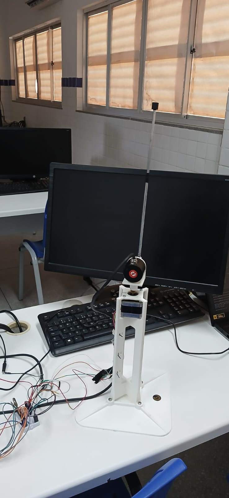
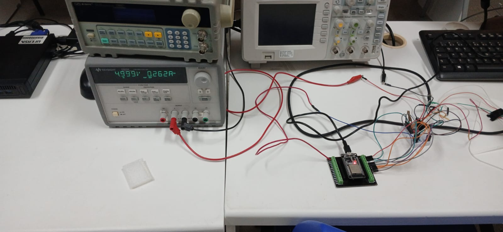
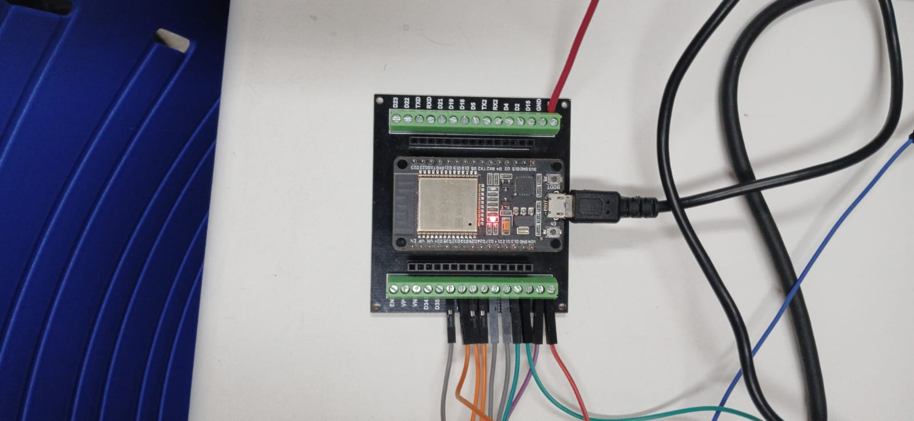

# Controle de Pêndulo Invertido Rotativo com ESP32 — PID via Lugar Geométrico das Raízes (LGR)

## Abstract

**Rotary Inverted Pendulum Control on ESP32 using Root-Locus PID Design**

This repository presents the complete mathematical modeling, Root-Locus (LGR) PID controller synthesis, and real-time embedded C/Arduino implementation for stabilizing a rotary inverted pendulum at its unstable upright equilibrium ($180^\circ$) using an **ESP32** microcontroller, a **NEMA 14 bipolar stepper motor** driven by an **A4988** microstepping driver ($1/16$ step, $3200\text{ steps/rev}$), and a **600 PPR incremental optical rotary encoder** ($2400\text{ CPR}$ in $4\times$ quadrature, $0.15^\circ/\text{pulse}$).

To overcome the practical challenges of stepper-driven inverted pendulums—such as electromagnetic interference (EMI) on encoder lines, derivative quantization spikes at $1\text{ kHz}$ sampling, and non-minimum phase arm drift—the firmware implements:
1. **A deterministic $20\text{ kHz}$ ($50\text{ }\mu\text{s}$) Hardware Timer ISR in `IRAM`** that simultaneously samples the quadrature encoder via direct register reads (`GPIO.in1.val`) with a state-transition lookup table (eliminating GPIO interrupt floods), synthesizes jitter-free `STEP` pulses via a 32-bit Direct Digital Synthesis (DDS) phase accumulator (`REG_WRITE`), and clocks the discrete PID control loop at an exact $1\text{ kHz}$ ($\Delta t = 1\text{ ms}$) rate.
2. **Production-Ready Firmware ([`firmware/final/`](firmware/final/)):** Bench-validated controller combining LGR gains ($K = 0.015601$, $z = 5.9888\text{ rad/s}$), a $15\text{ Hz}$ first-order low-pass derivative filter, smart 3-zone integrator with anti-windup, soft arm position/velocity feedback, and safety cable protection ($\pm 130^\circ$).
3. **Research and Reference Materials ([`materiais_pesquisa/`](materiais_pesquisa/)):** Academic reference implementations and future proposals for advanced state-space and observers.

---

## Bancada Experimental

| Pêndulo Equilibrado no Topo ($180^\circ$) | Bancada Experimental Completa | Eletrônica (ESP32 + Shield A4988) |
| :---: | :---: | :---: |
|  |  |  |

---

## Estrutura do Repositório

```text
control_systems/
├── README.md                          # Visão geral do projeto, fotos da bancada, hardware e guia de execução
├── docs/
│   ├── projeto.md                     # Memorial de cálculo completo em LaTeX (Modelagem, LGR e Ganhos)
│   ├── code.md                        # Documentação da arquitetura de tempo real, ISR de 20 kHz e filtros
│   ├── complementar.ipynb             # Cálculo automático de K e z + Validação da simulação
│   ├── img/                           # Fotos da bancada física e esquemáticos
│   │   ├── pendulo_equilibrado.jpeg   # Haste em equilíbrio vertical superior estável
│   │   ├── bancada.jpeg               # Visão geral da bancada experimental
│   │   └── esp32_shield.jpeg          # Microcontrolador ESP32 e Shield A4988
│   └── datasheets/                    # Datasheets do motor NEMA 14, driver A4988 e encoder incremental
│
├── firmware/                          # FIRMWARE FINAL DE PRODUÇÃO (Gravar na bancada)
│   └── final/                         # Diretório compatível com Arduino IDE
│       ├── final.ino                  # Código-fonte principal com temporizador de 20 kHz e controle a 1 kHz
│       ├── pid.c                      # Implementação do PID com filtro derivativo e anti-windup
│       └── pid.h                      # Estruturas e protótipos do controlador
│
├── materiais_pesquisa/                # MATERIAL DE APOIO, PESQUISA E CONTINUIDADE
│   ├── README.md                      # Descrição dos materiais de apoio
│   ├── ref/                           # Códigos de referência de laboratório e estudos iniciais
│   │   ├── pendulo_invertido_esp32_final.ino  # Implementação acadêmica com observador de estados
│   │   └── simples/                   # Versão inicial com FT pura sem filtros
│   │       ├── simples.ino
│   │       ├── pid.c
│   │       └── pid.h
│   └── proposta_futura/               # Propostas de melhorias analíticas futuras
│       ├── proposta_futura.ino
│       ├── pid.c
│       └── pid.h
│
└── dashboard/                         # Interface de telemetria e gráficos em tempo real
```

---

## Hardware e Pinagem (ESP32 DevKit 30 Pinos)

| Componente | Especificação | Pino ESP32 | Observação |
| :--- | :--- | :---: | :--- |
| **Encoder Incremental (Canal A)** | `E38S6G5-600B-G24N` ($600\text{ PPR} \implies 2400\text{ CPR}$ em $4\times$) | `GPIO 32` | Fio Verde (pull-up p/ $3,3\text{ V}$) |
| **Encoder Incremental (Canal B)** | Resolução de $0,15^\circ/\text{pulso}$ | `GPIO 33` | Fio Branco (pull-up p/ $3,3\text{ V}$) |
| **Driver Motor de Passo (`STEP`)** | `A4988` em $1/16$ microstepping ($3200\text{ passos/volta}$) | `GPIO 25` | Gerado via DDS a $20\text{ kHz}$ |
| **Driver Motor de Passo (`DIR`)** | Motor Bipolar NEMA 14 (`17PM-K044U`) | `GPIO 26` | Controle de sentido |
| **Driver Motor de Passo (`ENABLE`)**| Habilitação das bobinas | `GPIO 27` | Ativo em nível baixo (`LOW`) |

---

## Resumo dos Parâmetros de Projeto ([`docs/projeto.md`](docs/projeto.md))

* **Planta Linearizada:**
  $$G(s) = \frac{1398,89}{s^2 - 33,8276} \quad \left(p_{1,2} = \pm 5,8161\text{ rad/s}\right)$$
* **Critérios de Desempenho:** $UP = 5\%$ ($0,05$) e $T_s(2\%) = 0,5\text{ s}$ $\implies$ $\zeta = 0,6901$, $\omega_n = 11,5924\text{ rad/s}$, $s_d = -8,0000 \pm j8,3895$.
* **Controlador PID Projetado via LGR:**
  $$G_c(s) = \frac{K(s + z)^2}{s} = K_p + \frac{K_i}{s} + K_d s$$
  * $z = 5,9888\text{ rad/s}$
  * $K = K_d = 0,015601\text{ N}\cdot\text{m}\cdot\text{s/rad}$
  * $K_p = 2Kz = 0,186868\text{ N}\cdot\text{m/rad}$
  * $K_i = Kz^2 = 0,559556\text{ N}\cdot\text{m/(rad}\cdot\text{s)}$

---

## Como Executar na Bancada

1. Abra a pasta [`firmware/final/final.ino`](firmware/final/final.ino) na Arduino IDE (ou PlatformIO) e grave no ESP32.
2. Com a haste parada na posição vertical inferior ($0^\circ$), abra o Monitor Serial (`115200` baud).
3. Se necessário, envie `'c'` para calibrar a referência com a haste em repouso apontando para baixo ($0,00^\circ$).
4. Levante a haste manualmente até próximo ao topo ($180^\circ \pm 30^\circ$): o controle armará automaticamente (`ctrl=ON`).
5. Caso o braço gire mais de $\pm 130^\circ$, o desarme de segurança desliga o motor para proteger o cabo do encoder.
