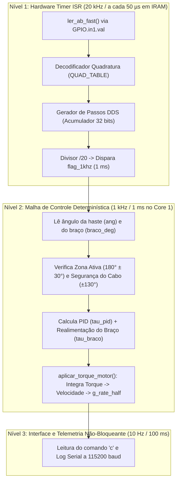

# Documentação de Arquitetura e Análise de Código — `firmware/melhorado`

Este documento detalha a arquitetura de tempo real, as otimizações de baixo nível para o microcontrolador **ESP32** e a implementação matemática do controlador PID projetado via Lugar Geométrico das Raízes (LGR) nos arquivos:
- [`melhorado.ino`](file:///home/anderson/github_projects/temp/controle2/repositorio/firmware/melhorado/melhorado.ino) — Firmware principal, ISR de $20\text{ kHz}$, acionamento DDS do motor de passo e malha de $1\text{ kHz}$.
- [`pid.h`](file:///home/anderson/github_projects/temp/controle2/repositorio/firmware/melhorado/pid.h) — Estrutura de dados `PID_t` e constantes do controlador ($f_c = 15\text{ Hz}$).
- [`pid.c`](file:///home/anderson/github_projects/temp/controle2/repositorio/firmware/melhorado/pid.c) — Implementação discreta do PID com filtro derivativo de 1ª ordem e limitação do torque máximo do motor ($\pm 0,14\text{ N}\cdot\text{m}$).

---

## 1. Arquitetura de Tempo Real e Execução no ESP32

O ESP32 possui dois núcleos Xtensa LX6 de 32 bits a $240\text{ MHz}$ com unidade de ponto flutuante (FPU) em hardware. No ambiente Arduino/FreeRTOS do ESP32:
- **Core 0 (`PRO_CPU`):** Executa as tarefas de sistema, *watchdog timers* e pilha de segundo plano do FreeRTOS.
- **Core 1 (`APP_CPU`):** Executa exclusivamente o `setup()`, o `loop()` (onde roda a malha do PID a $1\text{ kHz}$) e a rotina de interrupção de hardware [`onTimer20kHz()`](file:///home/anderson/github_projects/temp/controle2/repositorio/firmware/melhorado/melhorado.ino#L89-L132), garantindo que tarefas de sistema no Core 0 não interrompam o controle.

Além disso, o código é dividido em **três níveis temporais estritos**:



---

## 2. Análise Detalhada da ISR de $20\text{ kHz}$ e Seus Parâmetros ([`onTimer20kHz`](file:///home/anderson/github_projects/temp/controle2/repositorio/firmware/melhorado/melhorado.ino#L46-L132))

### 2.1 Por que a ISR em Registradores Diretos é Indispensável?
No `loop()`, o comando `Serial.printf(...)` leva de $3\text{ a }5\text{ ms}$ para transmitir os dados pela porta USB. Se a leitura do encoder ou a geração dos pulsos `STEP` ficassem no `loop()`, o motor sofreria engasgos a cada impressão Serial e o encoder perderia pulsos.

Mais ainda: no ESP32, as funções convencionais `digitalRead()` e `digitalWrite()` consultam tabelas de pinos armazenadas na **memória Flash SPI externa**. Chamar `digitalRead()`/`digitalWrite()` a $20\text{ kHz}$ ($60.000$ a $80.000$ acessos/s) gera disputas de barramento com a Flash (*cache misses*) e atrasos (*jitter*) que impedem o equilíbrio do pêndulo na bancada. Por isso, toda a ISR utiliza acesso direto a registradores em memória `IRAM`:

1. **`IRAM_ATTR` e `DRAM_ATTR` ([linhas 69-89](file:///home/anderson/github_projects/temp/controle2/repositorio/firmware/melhorado/melhorado.ino#L69-L89)):**
   - Alocam o código de `onTimer20kHz()`, `ler_ab_fast()` e a tabela `QUAD_TABLE[16]` diretamente na memória RAM interna rápida do ESP32, garantindo execução em menos de $1\text{ }\mu\text{s}$ sem nunca acessar a Flash.
2. **`ler_ab_fast()` via `GPIO.in1.val` ([linhas 77-82](file:///home/anderson/github_projects/temp/controle2/repositorio/firmware/melhorado/melhorado.ino#L77-L82)):**
   - No ESP32, os pinos `0` a `31` ficam no registrador `GPIO.in` e os pinos `32` a `39` ficam no registrador `GPIO.in1.val`. Como o encoder está nos pinos `32` (`PIN_ENC_A`) e `33` (`PIN_ENC_B`), `GPIO.in1.val` lê os dois canais simultaneamente em uma única instrução de clock.
3. **`REG_WRITE(GPIO_OUT_W1TS_REG / W1TC_REG, MASK)` ([linhas 65-66, 105, 116, 127](file:///home/anderson/github_projects/temp/controle2/repositorio/firmware/melhorado/melhorado.ino#L65-L66)):**
   - `STEP_MASK = (1UL << 25)` e `DIR_MASK = (1UL << 26)` identificam os bits dos pinos `25` e `26`.
   - Escrever no registrador `GPIO_OUT_W1TS_REG` (*Write 1 To Set*) coloca o pino em `HIGH` em 1 ciclo de clock ($\sim 4\text{ ns}$).
   - Escrever no registrador `GPIO_OUT_W1TC_REG` (*Write 1 To Clear*) coloca o pino em `LOW` em 1 ciclo de clock.

---

### 2.2 Papel de Cada Variável Global e de Estado da ISR

* **Qualificador `volatile`:** Informa ao compilador C que a variável é modificada assincronamente pela interrupção de hardware `onTimer20kHz()`, obrigando o `loop()` a sempre ler seu valor real na memória RAM.
* **Variáveis do Encoder e Relógio de $1\text{ kHz}$:**
  * `flag_1khz`: Bandeira que fica `true` a cada $20$ interrupções ($20 \times 50\text{ }\mu\text{s} = 1\text{ ms}$), disparando o cálculo do PID a exatos $1\text{ kHz}$.
  * `s_div_1khz`: Contador divisor de $0$ a $19$ que divide os $20\text{ kHz}$ da ISR para $1\text{ kHz}$.
  * `encoder_count`: Contador acumulado de pulsos do encoder ($2400$ contagens por volta em quadratura $4\times$).
  * `enc_state`: Byte que armazena os 2 bits anteriores (`[3:2]`) e os 2 bits atuais (`[1:0]`) dos canais A e B, formando um índice de $0$ a $15$ para consulta em `QUAD_TABLE[16]`.
* **Variáveis do Gerador de Passos DDS (*Direct Digital Synthesis*):**
  * `g_rate_half`: Incremento de fase com sinal enviado pelo `loop()` proporcional à frequência de passos desejada:
    $$g_{\text{rate\_half}} = f_{\text{step}} \cdot \frac{2^{31}}{20000}$$
  * `s_phase`: Acumulador de fase de 32 bits (`uint32_t`). A cada $50\text{ }\mu\text{s}$, soma `inc = |g_rate_half| << 1`. Quando `s_phase` transborda $2^{32}$ (`s_phase < old`), é hora de emitir $1$ pulso `STEP`.
  * `s_pulse_high`: Indica que o pino `STEP` subiu para `HIGH` na interrupção anterior e deve ser baixado para `LOW` na interrupção atual (garantindo largura de pulso fixa de $50\text{ }\mu\text{s}$).
  * `just_cleared`: Indica que o pino `STEP` acabou de descer para `LOW` neste ciclo, impedindo que ele suba novamente para `HIGH` no mesmo instante (garantindo no mínimo $50\text{ }\mu\text{s}$ de nível `LOW` entre dois pulsos).
  * `s_pending`: Guarda na memória que o acumulador `s_phase` transbordou. Se o transbordo acontecer justo num ciclo em que `just_cleared == true`, `s_pending = true` retém o pedido e dispara o pulso no ciclo seguinte sem perder a contagem de fase!
  * `s_dir_cur`: Guarda o sentido atual do motor (`+1` ou `-1`). Quando o PID inverte o sentido (`dir != s_dir_cur`), a ISR muda o pino `DIR` e retorna (`return;`), aguardando $1$ ciclo completo ($50\text{ }\mu\text{s}$) de estabilização (*setup time*) do driver `A4988` antes de emitir o próximo pulso `STEP`.
  * `g_step_pos`: Posição acumulada do braço do motor em microsteps (`+1` ou `-1` a cada pulso `STEP` emitido), permitindo calcular `braco_rad` sem necessidade de um segundo encoder no eixo do motor.

---

## 3. Leitura do Encoder em Quadratura a $20\text{ kHz}$ e Funcionamento da `QUAD_TABLE[16]`

Em projetos que utilizam `attachInterrupt()` nos pinos do encoder, o ruído eletromagnético (EMI) gerado pelo chaveamento de corrente do driver `A4988` dispara dezenas de milhares de interrupções falsas por segundo, travando a CPU e a porta Serial.

No [`melhorado.ino`](file:///home/anderson/github_projects/temp/controle2/repositorio/firmware/melhorado/melhorado.ino#L91-L93), o encoder de $600\text{ PPR}$ ($2400\text{ CPR}$ em quadratura $4\times$, resolução de $0,15^\circ/\text{pulso}$) é amostrado sincronicamente a **$20\text{ kHz}$** (a cada $50\text{ }\mu\text{s}$):

```cpp
uint8_t ab = ler_ab_fast();                    // Lê os 2 bits atuais: (AB)
enc_state = ((enc_state << 2) | ab) & 0x0F;    // Junta os 2 bits ANTIGOS com os 2 bits NOVOS
encoder_count += QUAD_TABLE[enc_state];        // Olha na tabela se andou +1, -1 ou 0
```

### 3.1 Como Funciona a Máquina de Estados da `QUAD_TABLE[16]`

O encoder possui **2 fios de sinal** (`Canal A` e `Canal B`), onde cada fio assume `0` (`LOW`) ou `1` (`HIGH`). Quando o eixo gira, os dois fios mudam um de cada vez seguindo o código Gray de 4 estados:
* **Sentido Positivo (`+1`):** `00` $\to$ `10` $\to$ `11` $\to$ `01` $\to$ `00`
* **Sentido Negativo (`-1`):** `00` $\to$ `01` $\to$ `11` $\to$ `10` $\to$ `00`

A cada $50\text{ }\mu\text{s}$, a variável `enc_state` junta os **2 bits da leitura anterior** com os **2 bits da leitura atual**, formando um índice de **4 bits** (de `0` a `15` em decimal):

$$\text{enc\_state} = [\underbrace{A_{\text{antigo}}\; B_{\text{antigo}}}_{\text{Onde estava}} \;\; \underbrace{A_{\text{novo}}\; B_{\text{novo}}}_{\text{Para onde foi}}]$$

A tabela `QUAD_TABLE[16]` é uma matriz $4 \times 4$ (4 estados antigos $\times$ 4 estados novos) achatada em um vetor de 16 posições:

```cpp
//                     Para onde foi (ab novo):
//                     00(0)  01(1)  10(2)  11(3)
static const int8_t DRAM_ATTR QUAD_TABLE[16] = {
/* Estava em 00 (0) */   0,    -1,    +1,     0,   // Índices  0,  1,  2,  3
/* Estava em 01 (1) */  +1,     0,     0,    -1,   // Índices  4,  5,  6,  7
/* Estava em 10 (2) */  -1,     0,     0,    +1,   // Índices  8,  9, 10, 11
/* Estava em 11 (3) */   0,    +1,    -1,     0    // Índices 12, 13, 14, 15
};
```

### 3.2 Exemplos Práticos de Consulta na Tabela

1. **Haste Parada (Sem Movimento):**
   - Leitura anterior: `01`; Leitura atual: `01`.
   - `enc_state` = binário `0101` = índice **`5`**.
   - `QUAD_TABLE[5] = 0` $\implies$ soma `0` em `encoder_count`.
2. **Haste Girou 1 Pulso no Sentido Positivo (`+0,15°`):**
   - Leitura anterior: `00`; Leitura atual: `10`.
   - `enc_state` = binário `0010` = índice **`2`**.
   - `QUAD_TABLE[2] = +1` $\implies$ soma `+1` em `encoder_count`.
3. **Pico de Ruído Elétrico nos Dois Fios Simultaneamente (Transição Inválida):**
   - Leitura anterior: `00`; Leitura atual: `11` (fisicamente impossível em um giro real, pois os dois canais nunca mudam juntos).
   - `enc_state` = binário `0011` = índice **`3`**.
   - `QUAD_TABLE[3] = 0` $\implies$ **ignora o ruído automaticamente!**

Dessa forma, em vez de dezenas de comandos `if/else`, o microcontrolador decodifica o encoder e filtra ruídos em apenas 3 instruções de máquina.

---

## 4. Biblioteca do Controlador PID ([`pid.h`](file:///home/anderson/github_projects/temp/controle2/repositorio/firmware/melhorado/pid.h) e [`pid.c`](file:///home/anderson/github_projects/temp/controle2/repositorio/firmware/melhorado/pid.c))

### 4.1 Inicialização Direta pelos Parâmetros do LGR ([`PID_InitKz`](file:///home/anderson/github_projects/temp/controle2/repositorio/firmware/melhorado/pid.c#L21-L29))
O controlador foi projetado via Lugar Geométrico das Raízes com dois zeros reais iguais em $s = -z$:
$$G_c(s) = \frac{K(s + z)^2}{s} = 2Kz + \frac{Kz^2}{s} + K s = K_p + \frac{K_i}{s} + K_d s$$
Com `K_LGR = 0.015601` e `Z_LGR = 5.9888` ($\Delta t = 0,001\text{ s}$), a função `PID_InitKz()` calcula automaticamente:
- $K_p = 2 K z = \mathbf{0,186868}\text{ N}\cdot\text{m/rad}$
- $K_i = K z^2 = \mathbf{0,559556}\text{ N}\cdot\text{m/(rad}\cdot\text{s)}$
- $K_d = K = \mathbf{0,015601}\text{ N}\cdot\text{m/(rad/s)}$

### 4.2 Filtro Passa-Baixas na Derivada (`DERIV_FILT_HZ = 15.0f`) — Funcionamento e Justificativa

#### A. O Problema Físico: Quantização do Encoder em $1\text{ kHz}$
Na teoria contínua ($s$), a posição angular $\theta(t)$ é uma função contínua e derivável. Porém, no sistema embarcado real, o encoder incremental (`600 PPR` $\implies$ `2400 pulsos/volta` em quadratura $4\times$) mede o ângulo em **degraus discretos** de:
$$\Delta\theta_{\min} = \frac{360^\circ}{2400} = 0,15^\circ = 0,002618\text{ rad}$$

Como a malha do PID roda a **$1\text{ kHz}$** ($\Delta t = 0,001\text{ s}$), quando o pêndulo está próximo do equilíbrio no topo, a haste não cruza uma borda do encoder em todos os milissegundos. Isso faz com que a derivada numérica pura $\frac{e[k] - e[k-1]}{\Delta t}$ se comporte como um trem de impulsos:
- Em várias amostras consecutivas de $1\text{ ms}$, o encoder não muda de contagem $\implies$ a derivada bruta vale **$0\text{ rad/s}$**.
- No milissegundo exato em que o encoder varia **$1$ único pulso** ($0,15^\circ$), a derivada bruta salta instantaneamente para:
  $$\dot{e}_{\text{bruta}} = \frac{0,002618\text{ rad}}{0,001\text{ s}} = \mathbf{2,618\text{ rad/s}} \quad (150^\circ/\text{s})$$
- Na amostra seguinte ($1\text{ ms}$ depois), volta para **$0\text{ rad/s}$**.

Sem filtragem, a ação derivativa ($K_d \cdot \dot{e}$) injeta esses espigões de alta frequência diretamente no torque comandado, fazendo o motor de passo vibrar, aquecer e perder passos no topo.

#### B. Implementação Matemática (Filtro IIR Passa-Baixas de 1ª Ordem)
Em vez de aplicar o ganho $K_d$ sobre `deriv_bruta`, o código em [`pid.c` (linhas 47-50)](file:///home/anderson/github_projects/temp/controle2/repositorio/firmware/melhorado/pid.c#L47-L50) passa a derivada por um filtro exponencial de 1ª ordem:

```c
float deriv_bruta = (e - pid->erro_anterior) / pid->dt;
pid->deriv_filtrada += pid->alpha_d * (deriv_bruta - pid->deriv_filtrada);
```

Na forma de equação a diferenças:
$$\dot{e}_{\text{filt}}[k] = (1 - \alpha_d)\cdot \dot{e}_{\text{filt}}[k-1] + \alpha_d \cdot \left(\frac{e[k] - e[k-1]}{\Delta t}\right)$$

Onde o coeficiente $\alpha_d$ é calculado por casamento de polo em [`pid.c` (linha 15)](file:///home/anderson/github_projects/temp/controle2/repositorio/firmware/melhorado/pid.c#L15) para $f_c = 15,0\text{ Hz}$:
$$\alpha_d = 1 - e^{-2\pi f_c \Delta t} = 1 - e^{-2\pi \cdot 15 \cdot 0,001} \approx \mathbf{0,0899}$$

Na prática, quando ocorre um salto de $1$ pulso no encoder, o filtro absorve apenas $\approx 9\%$ desse pico no primeiro milissegundo e distribui o restante suavemente pelas amostras seguintes, reconstruindo a velocidade angular real da haste.

#### C. Justificativa da Frequência de Corte em $15\text{ Hz}$ (Separação Espectral)
- **Dinâmica física do pêndulo e da malha fechada:**
  - Polo gravitacional da planta ($p = 5,82\text{ rad/s}$): $f_{\text{planta}} = \frac{5,82}{2\pi} \approx \mathbf{0,93\text{ Hz}}$.
  - Frequência natural de malha fechada ($\omega_n = 11,59\text{ rad/s}$): $f_n = \frac{11,59}{2\pi} \approx \mathbf{1,84\text{ Hz}}$.
- **Ruído de quantização da amostragem:** concentrado entre **$100\text{ Hz}$ e $1000\text{ Hz}$**.

Com o corte ajustado em **$f_c = 15\text{ Hz}$**:
1. A frequência de corte fica **quase $10\times$ acima** da frequência natural da malha fechada ($\sim 1,84\text{ Hz}$), preservando o avanço de fase da ação derivativa projetado no LGR sem atrasar a resposta do controlador.
2. Ao mesmo tempo, fica muito abaixo da frequência de amostragem de $1000\text{ Hz}$, atenuando mais de $90\%$ dos espigões de quantização do encoder (melhoria validada experimentalmente na bancada ao reduzir $f_c$ de $45\text{ Hz}$ para $15\text{ Hz}$).

---

### 4.3 Termo Integral (`I`), Estratégia de Esquecimento (`leak_i`) e Limitação do Torque ($\pm 0,14\text{ N}\cdot\text{m}$)

Nas [linhas 53-68 de `pid.c`](file:///home/anderson/github_projects/temp/controle2/repositorio/firmware/melhorado/pid.c#L53-L68):

```c
float i_novo = (pid->integral * pid->leak_i) + e * pid->dt;
float I = pid->Ki * i_novo;

float u = P + I + D;

if (u > pid->limite_torque) {
    u = pid->limite_torque;
    if (e < 0.0f) pid->integral = i_novo;
} else if (u < -pid->limite_torque) {
    u = -pid->limite_torque;
    if (e > 0.0f) pid->integral = i_novo;
} else {
    pid->integral = i_novo;
}
```

#### A. Soma Discreta da Integral e a Estratégia do `leak_i = 0.995f`
- **O Problema da Subida Manual ($150^\circ \to 180^\circ$):** O controle liga automaticamente assim que a haste entra na janela de captura ($150^\circ$). Enquanto o operador termina de levantar a haste com a mão de $150^\circ$ até $180^\circ$, existe um erro grande durante várias centenas de milissegundos ($e = 30^\circ, 20^\circ, 10^\circ\dots$). Se o integrador acumulasse $100\%$ desse erro passado sem esquecimento, no instante em que a haste chegasse ao topo ($180^\circ$, erro $e = 0^\circ$), a variável `pid->integral` estaria carregada com um valor elevado e **arremessaria a haste para o lado oposto**.
- **Como o `leak_i = 0.995f` resolve:** A cada ciclo de $1\text{ ms}$, o acumulado anterior é multiplicado por $0,995$ antes de somar a nova área do erro ($e \cdot \Delta t$):
  $$i_{\text{novo}} = (i_{\text{anterior}} \cdot 0,995) + e \cdot \Delta t$$
  Isso faz com que a memória antiga evapore $0,5\%$ por milissegundo (constante de tempo de $\tau_{\text{leak}} \approx 200\text{ ms}$), limpando rapidamente o histórico da subida manual, mas mantendo a ação integral ativa no topo para corrigir pequenos desalinhamentos em torno de $180^\circ$.

#### B. Por que usar a variável provisória `i_novo` e o `if` de Limitação de Torque?
O motor de passo NEMA 14 suporta no máximo **`limite_torque = 0.14` $\text{N}\cdot\text{m}$**. Antes de salvar `i_novo` definitivamente em `pid->integral`, o código soma `u = P + I + D` e verifica três casos:
1. **Funcionamento normal dentro da faixa (`-0.14 <= u <= +0.14`):**
   - Cai no `else` e salva normalmente `pid->integral = i_novo`.
2. **Torque bateu no limite positivo (`u > +0.14`):**
   - Trava a saída no teto físico (`u = +0.14`).
   - Como o motor já está entregando $100\%$ da força positiva possível, se o erro ainda for positivo (`e > 0`), continuar somando `i_novo` só faria a variável `pid->integral` crescer indefinidamente sem aumentar a força do motor. Por isso, ele **congela `pid->integral`** e só aceita atualizar `pid->integral = i_novo` quando `e < 0.0f` (ou seja, quando o erro inverte de sinal e ajuda a diminuir a integral para sair do teto).
3. **Torque bateu no limite negativo (`u < -0.14`):**
   - Trava a saída no piso físico (`u = -0.14`) e, de forma espelhada, só aceita atualizar `pid->integral = i_novo` se `e > 0.0f` (ajudando a puxar a soma de volta para dentro da faixa).

---

## 5. Malha de Controle Composta e Conversão Física para o Motor de Passo

A cada $1\text{ ms}$ (`if (flag_1khz)` nas [linhas 231-281 de `melhorado.ino`](file:///home/anderson/github_projects/temp/controle2/repositorio/firmware/melhorado/melhorado.ino#L231-L281)):

1. **Janela de Captura e Proteção do Cabo:**
   - O motor só é acionado quando a haste está a $\pm 30^\circ$ do topo (`150° <= ang <= 210°`) e o braço não excedeu $\pm 130^\circ$ (`LIMITE_BRACO_DEG`).
   - No instante exato em que a haste entra na zona ativa, o PID é zerado (`PID_Reset`), `pid.erro_anterior` é inicializado com o ângulo atual (evitando coice derivativo no primeiro ciclo) e `step_zero = g_step_pos` define o centro `0.0°` do braço.

2. **Lei de Controle (Haste + Centralização do Braço) e Explicação dos Sinais:**
   ```cpp
   float tau_pid   = PID_Calcular(&pid, SETPOINT_GRAUS, ang);
   float tau_braco = -K_POS_BRACO * braco_rad - K_VEL_BRACO * vel_cmd_rad_s;
   tau = -(tau_pid + tau_braco);
   ```
   - **Por que o sinal `-` fora dos parênteses (`-(...)`)?**
     Serve para casar o sentido físico da fiação das bobinas do motor NEMA 14 no driver `A4988` com o sentido do encoder. Quando a haste cai de $180^\circ$ para $175^\circ$, o erro fica positivo ($e = +5^\circ \implies \tau_{\text{pid}} > 0$). Na montagem física da bancada, o sentido de rotação que move a base para debaixo da queda da haste corresponde ao sentido negativo dos passos (`dir = -1`), exigindo a inversão `-(...)`.
   - **Por que `tau_braco` tem sinais negativos que, multiplicados pelo `-` externo, entram como positivos no motor (`+K_POS_BRACO * braco_rad + K_VEL_BRACO * vel_cmd_rad_s`)?**
     Isso decorre do **comportamento de fase não-mínima** do pêndulo invertido (planta instável em malha aberta). Pense na analogia de equilibrar um cabo de vassoura na palma da mão:
     - Se a sua mão se deslocou para a **direita** (`braco_rad > 0`) e você deseja trazê-la de volta para o **centro (`0°`, esquerda)** sem derrubar a vassoura, você **não pode** simplesmente puxar a mão para a esquerda (contra o deslocamento), pois a vassoura cairia imediatamente para a direita.
     - Para voltar ao centro, é preciso primeiro dar um leve avanço com a mão **a favor do deslocamento (para a direita, `+`)**, inclinando a vassoura sutilmente para a esquerda; em seguida, o próprio controlador principal (`tau_pid`), ao reagir para segurar essa inclinação da haste, conduz todo o conjunto (haste + braço) de volta para a esquerda até `braco_rad = 0°`.
     - Matematicamente, pelo critério de Routh-Hurwitz aplicado a uma planta com polo instável no semiplano direito, o ganho de realimentação da base precisa ter esse sinal para que todos os coeficientes do polinômio característico de malha fechada permaneçam positivos e estáveis.

3. **Conversão Física Torque $\to$ Frequência de Passos ([`aplicar_torque_motor`](file:///home/anderson/github_projects/temp/controle2/repositorio/firmware/melhorado/melhorado.ino#L153-L175)):**
   - A partir do torque limitado $\tau \in [-0,14;\; +0,14]\text{ N}\cdot\text{m}$, calcula-se a aceleração angular física:
     $$\alpha_{\text{cmd}} = \frac{\tau}{J}, \quad \text{com } J = m l^2 = 0,00071485\text{ kg}\cdot\text{m}^2$$
   - Integra-se a aceleração no tempo ($\Delta t = 1\text{ ms}$) para obter a velocidade angular comandada $\omega_{\text{cmd}}$ e converte-se para frequência de microsteps ($3200\text{ passos/volta}$):
     $$\omega_{\text{cmd}}[k] = \omega_{\text{cmd}}[k-1] + \alpha_{\text{cmd}}\cdot \Delta t \implies f_{\text{step}} = \omega_{\text{cmd}}[k] \cdot \frac{3200}{2\pi}\text{ Hz}$$
   - Por fim, aplica-se o limite máximo validado em bancada (**`FREQ_MAX_HZ = 4000.0f`**) tanto em `freq_signed` quanto na variável de estado `vel_cmd_rad_s` (evitando perda de sincronismo do motor NEMA 14).
