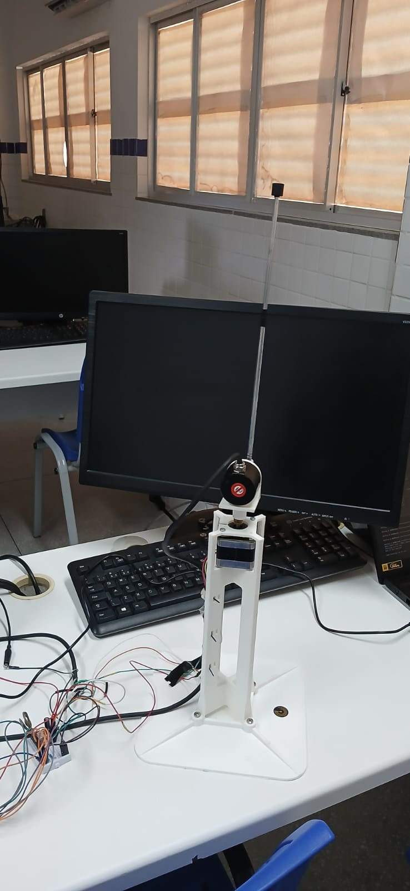
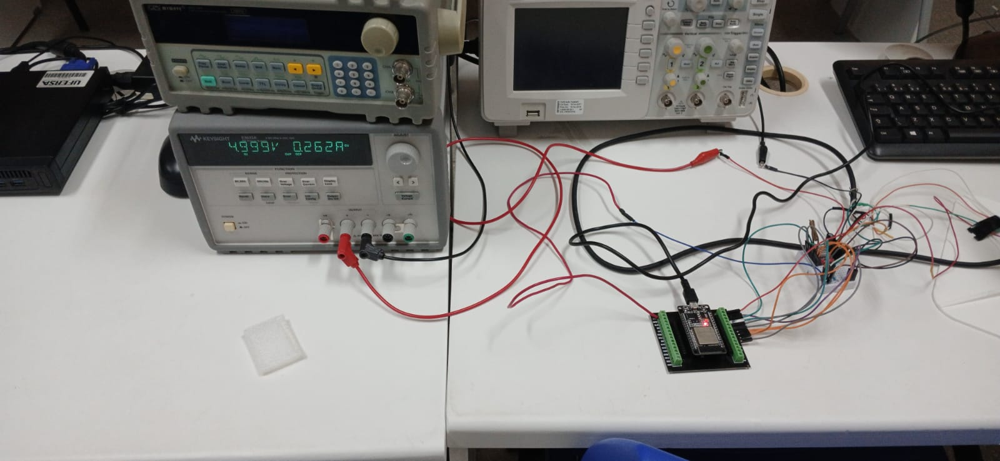
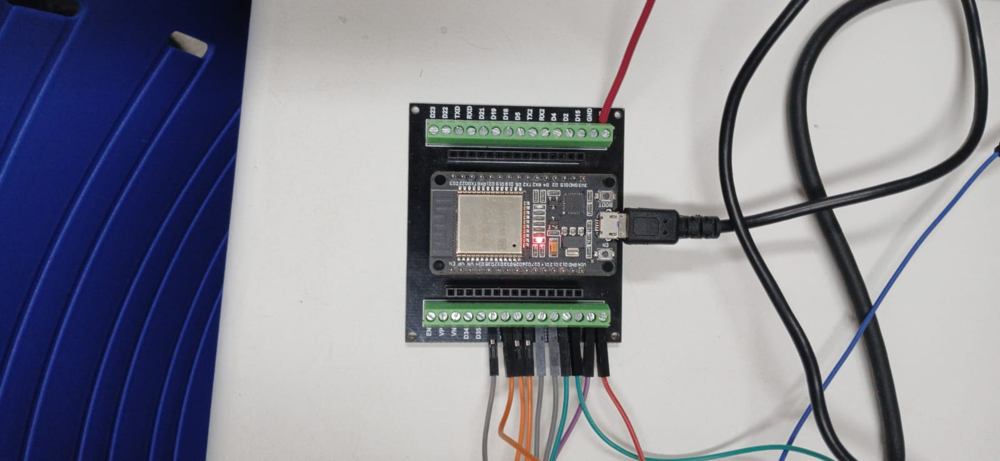

# Projeto do Controlador PID via Lugar Geométrico das Raízes (LGR) — Pêndulo Invertido

Este documento apresenta o memorial de cálculo completo do projeto de controle para estabilização do pêndulo invertido na posição vertical superior ($180^\circ$), partindo da modelagem física da planta até a obtenção analítica dos parâmetros $(K, z)$ pelo Lugar Geométrico das Raízes (LGR) e sua conversão para os ganhos $(K_p, K_i, K_d)$ implementados no firmware de produção [`firmware/final/pid.h`](file:///home/anderson/github_projects/control_systems/firmware/final/pid.h).

---

## Bancada Experimental Física

| Haste Equilibrada a $180^\circ$ | Bancada Experimental Completa | Eletrônica (ESP32 DevKit + Driver A4988) |
| :---: | :---: | :---: |
|  |  |  |

---

## 1. Modelagem Matemática e Função de Transferência da Planta

O sistema consiste em um pêndulo invertido acionado por um torque externo $\tau(t)$ na articulação. Considerando uma haste rígida de massa desprezível de comprimento $l$ com uma massa concentrada $m$ em sua extremidade, aplicamos a Segunda Lei de Newton para rotação ($\sum \tau = J\ddot{\theta}$). No topo ($180^\circ$), o torque gravitacional atua a favor do deslocamento angular $\theta(t)$:

$$J\ddot{\theta}(t) = mgl\sin(\theta(t)) + \tau(t)$$

Onde:
* $J = ml^2$: Momento de inércia da massa concentrada em relação ao pivô ($\text{kg}\cdot\text{m}^2$).
* $g = 9,81\text{ m/s}^2$: Aceleração da gravidade.
* $m = 8,5\text{ g} = 0,0085\text{ kg}$: Massa do pêndulo.
* $l = 29\text{ cm} = 0,29\text{ m}$: Comprimento da haste até o centro de gravidade.
* $\theta(t)$: Deslocamento angular em relação à posição vertical superior de equilíbrio ($\text{rad}$).
* $\tau(t)$: Torque de controle aplicado no eixo ($\text{N}\cdot\text{m}$).

### 1.1. Linearização em torno do Ponto de Operação ($\theta \approx 0$)

Para pequenos ângulos em torno do equilíbrio vertical superior, aproxima-se $\sin(\theta(t)) \approx \theta(t)$ e passa-se o termo gravitacional para o lado esquerdo da equação:

$$ml^2\ddot{\theta}(t) - mgl\theta(t) = \tau(t)$$

### 1.2. Aplicação da Transformada de Laplace

Assumindo condições iniciais nulas ($\theta(0) = 0$ e $\dot{\theta}(0) = 0$), obtemos a equação algébrica no domínio da frequência complexa $s$:

$$(ml^2 s^2 - mgl)\Theta(s) = T(s)$$

Isolando a razão entre a saída angular $\Theta(s)$ e a entrada de torque $T(s)$, chegamos à Função de Transferência em malha aberta $G(s)$:

$$G(s) = \frac{\Theta(s)}{T(s)} = \frac{\frac{1}{ml^2}}{s^2 - \frac{g}{l}}$$

### 1.3. Substituição dos Parâmetros Físicos no SI

1. **Momento de Inércia ($J$):**
   $$J = m \cdot l^2 = 0,0085 \times (0,29)^2 = 0,0085 \times 0,0841 = 0,00071485\text{ kg}\cdot\text{m}^2$$

2. **Ganho do Numerador ($\frac{1}{ml^2}$):**
   $$\frac{1}{J} = \frac{1}{0,00071485} \approx 1398,8949\text{ kg}^{-1}\cdot\text{m}^{-2}$$

3. **Termo Gravitacional ($\frac{g}{l}$):**
   $$\frac{g}{l} = \frac{9,81}{0,29} \approx 33,8276\text{ s}^{-2}$$

Portanto, a Função de Transferência da planta é:

$$G(s) = \frac{1398,89}{s^2 - 33,8276}$$

Igualando o denominador a zero para encontrar os **polos de malha aberta da planta**:

$$s^2 - 33,8276 = 0 \implies s^2 = +33,8276 \implies p_{1,2} = \pm\sqrt{33,8276} = \pm 5,8161\text{ rad/s}$$

Como $s^2 = +33,8276 > 0$, os dois polos são **números reais puros** situados sobre o **eixo real ($\sigma$)**:
* $p_1 = +5,8161\text{ rad/s}$ (polo instável no semiplano direito — SPD)
* $p_2 = -5,8161\text{ rad/s}$ (polo estável no semiplano esquerdo — SPE)

---

## 2. Critérios de Desempenho

Para garantir uma estabilização rápida e com baixo sobresinal em torno do topo, especificam-se os seguintes requisitos para a resposta transitória ao degrau:

* **Ultrapassagem Percentual ($UP$):**
  $$UP = 5\% = 0,05$$
* **Tempo de Acomodação ($T_s$, critério de $2\%$):**
  $$T_s = 0,5\text{ s}$$

---

## 3. Cálculo do Fator de Amortecimento ($\zeta$) e Frequência Natural ($\omega_n$)

### 3.1. Fator de Amortecimento ($\zeta$)

A relação analítica entre a ultrapassagem percentual $UP$ e o fator de amortecimento $\zeta$ de um sistema de 2ª ordem subamortecido ($0 < \zeta < 1$) é dada por:

$$UP = e^{-\frac{\zeta \pi}{\sqrt{1 - \zeta^2}}}$$

Aplicando o logaritmo natural ($\ln$) em ambos os lados e elevando ao quadrado para isolar $\zeta$:

$$\ln(UP) = -\frac{\zeta \pi}{\sqrt{1 - \zeta^2}} \implies \big(\ln(UP)\big)^2 (1 - \zeta^2) = \zeta^2 \pi^2$$

$$\big(\ln(UP)\big)^2 = \zeta^2 \left[ \pi^2 + \big(\ln(UP)\big)^2 \right] \implies \zeta = \frac{-\ln(UP)}{\sqrt{\pi^2 + \big(\ln(UP)\big)^2}}$$

Substituindo $UP = 0,05$:

1. $\ln(0,05) = -2,995732 \implies -\ln(0,05) = 2,995732$
2. $\big(\ln(0,05)\big)^2 = (-2,995732)^2 = +8,974412$
3. $\pi^2 = (3,141593)^2 = 9,869604$
4. Soma no interior da raiz:
   $$\pi^2 + \big(\ln(0,05)\big)^2 = 9,869604 + 8,974412 = 18,844016$$
5. Extração da raiz quadrada e divisão:
   $$\zeta = \frac{2,995732}{\sqrt{18,844016}} = \frac{2,995732}{4,340970} \implies \mathbf{\zeta = 0,6901}$$

### 3.2. Frequência Natural Não-Amortecida ($\omega_n$)

Pela equação do tempo de acomodação para o critério de $2\%$ ($T_s = \frac{4}{\zeta \omega_n}$):

$$\omega_n = \frac{4}{\zeta \cdot T_s}$$

Substituindo $\zeta = 0,690107$ e $T_s = 0,5\text{ s}$:

$$\omega_n = \frac{4}{0,690107 \times 0,5} = \frac{4}{0,345053} \implies \mathbf{\omega_n = 11,5924\text{ rad/s}}$$

---

## 4. Polos Dominantes de Malha Fechada ($s_d$)

Os polos dominantes complexos conjugados de 2ª ordem são definidos por:

$$s_d = -\sigma_d \pm j\omega_d = -\zeta\omega_n \pm j\omega_n\sqrt{1 - \zeta^2}$$

Calculando a parte real ($\sigma_d$) e a frequência natural amortecida ($\omega_d$):

1. **Parte Real ($\sigma_d$):**
   $$\sigma_d = \zeta \cdot \omega_n = 0,690107 \times 11,592410 = \mathbf{8,0000\text{ s}^{-1}}$$
   *(Nota: $\sigma_d = \frac{4}{T_s} = \frac{4}{0,5} = 8,0000\text{ s}^{-1}$).*

2. **Parte Imaginária ($\omega_d$):**
   $$\omega_d = \omega_n\sqrt{1 - \zeta^2} = 11,592410 \times \sqrt{1 - (0,690107)^2} = 11,592410 \times \sqrt{0,523752} = 11,592410 \times 0,723707 = \mathbf{8,3895\text{ rad/s}}$$

Portanto, os polos dominantes desejados são:

$$\mathbf{s_d = -8,0000 \pm j8,3895}$$

---

## 5. Estrutura do Controlador PID no Lugar Geométrico das Raízes (LGR)

Adota-se um controlador PID com dois **zeros reais repetidos** alocados em $s = -z$ ($z > 0$) e ganho de LGR $K$:

$$G_c(s) = \frac{K(s + z)^2}{s}$$

Assim, a função de transferência de laço aberto $G_{ma}(s) = G_c(s)G(s)$ possui:
* **3 Polos de malha aberta sobre o eixo real ($\text{Im} = 0$):**
  * $p_0 = 0$ (polo integrador do PID na origem)
  * $p_1 = +5,8161\text{ rad/s}$ (polo instável da planta no SPD)
  * $p_2 = -5,8161\text{ rad/s}$ (polo estável da planta no SPE)
* **2 Zeros de malha aberta repetidos sobre o eixo real:**
  * $z_1 = z_2 = -z$

$$G_{ma}(s) = G_c(s)G(s) = \frac{K(s + z)^2}{s} \cdot \frac{1398,89}{s^2 - 33,8276}$$

---

## 6. Condição de Fase do LGR e Cálculo do Zero Duplo ($z$)

Para que o polo dominante $s_d = -8,0000 + j8,3895$ pertença ao Lugar Geométrico das Raízes, a condição de fase exige que a soma dos ângulos dos zeros menos a soma dos ângulos dos polos (avaliados em $s_d$) seja um múltiplo ímpar de $\pm 180^\circ$:

$$\sum \angle(\text{zeros em } s_d) - \sum \angle(\text{polos em } s_d) = -180^\circ$$

$$2\phi_z - (\theta_{p_0} + \theta_{p_1} + \theta_{p_2}) = -180^\circ$$

Onde $\phi_z = \angle(s_d + z)$ é o ângulo de cada um dos dois zeros em $s = -z$.

### 6.1. Cálculo dos Ângulos dos Polos pelos Triângulos Geométricos no LGR

Como os três polos ($p_0 = 0$, $p_1 = +5,8161$ e $p_2 = -5,8161$) estão sobre o **eixo real (horizontal)**, a altura vertical de todos os triângulos retângulos até $s_d = -8,0000 + j8,3895$ é fixa em $\omega_d = 8,3895$ (numerador), enquanto a base horizontal (denominador do arco-tangente) varia conforme a distância horizontal de cada polo até $-8,0000$:

$$\beta_i = \tan^{-1}\!\left(\frac{\omega_d}{|\sigma_d - p_i|}\right), \qquad \theta_{p_i} = 180^\circ - \beta_i$$

1. **Polo Integrador na Origem ($p_0 = 0$):**
   * Cateto vertical (oposto): $8,3895$
   * Cateto horizontal (adjacente, de $-8$ até $0$): $8,0000$
   $$\beta_0 = \tan^{-1}\!\left(\frac{8,3895}{8,0000}\right) = \tan^{-1}(1,048689) = 46,3614^\circ$$
   $$\theta_{p_0} = 180^\circ - 46,3614^\circ = \mathbf{133,6386^\circ}$$

2. **Polo Instável da Planta ($p_1 = +5,8161$):**
   * Cateto vertical (oposto): $8,3895$
   * Cateto horizontal (adjacente, de $-8$ até $+5,8161$): $8,0000 + 5,8161 = 13,8161$
   $$\beta_1 = \tan^{-1}\!\left(\frac{8,3895}{8,0000 + 5,8161}\right) = \tan^{-1}\!\left(\frac{8,3895}{13,8161}\right) = \tan^{-1}(0,607226) = 31,2672^\circ$$
   $$\theta_{p_1} = 180^\circ - 31,2672^\circ = \mathbf{148,7328^\circ}$$

3. **Polo Estável da Planta ($p_2 = -5,8161$):**
   * Cateto vertical (oposto): $8,3895$
   * Cateto horizontal (adjacente, de $-8$ até $-5,8161$): $8,0000 - 5,8161 = 2,1839$
   $$\beta_2 = \tan^{-1}\!\left(\frac{8,3895}{8,0000 - 5,8161}\right) = \tan^{-1}\!\left(\frac{8,3895}{2,1839}\right) = \tan^{-1}(3,841628) = 75,4093^\circ$$
   $$\theta_{p_2} = 180^\circ - 75,4093^\circ = \mathbf{104,5907^\circ}$$

* **Soma dos ângulos dos polos:**
  $$\sum \theta_p = 133,6386^\circ + 148,7328^\circ + 104,5907^\circ = \mathbf{386,9621^\circ}$$

### 6.2. Cálculo do Ângulo $\phi_z$ e da Posição do Zero $z$

Isolando $\phi_z$ na equação da condição de fase:

$$2\phi_z - 386,9621^\circ = -180^\circ \implies 2\phi_z = 206,9621^\circ \implies \mathbf{\phi_z = 103,4810^\circ}$$

O ângulo interno do triângulo do zero com o semieixo real negativo é o suplementar $\alpha_z = 180^\circ - \phi_z$:

$$\alpha_z = 180^\circ - 103,4810^\circ = \mathbf{76,5190^\circ}$$

Pelo triângulo geométrico formado entre o zero em $-z$ e o polo dominante $s_d = -8,0000 + j8,3895$:

$$\tan(\alpha_z) = \frac{\omega_d}{\sigma_d - z} \implies \sigma_d - z = \frac{\omega_d}{\tan(\alpha_z)} \implies z = \sigma_d - \frac{\omega_d}{\tan(\alpha_z)}$$

Substituindo $\sigma_d = 8,0000$, $\omega_d = 8,3895$ e $\tan(76,5190^\circ) = 4,171381$:

$$z = 8,0000 - \frac{8,389515}{4,171381} = 8,0000 - 2,011208 \implies \mathbf{z = 5,9888\text{ rad/s}}$$

Portanto, o zero duplo do controlador está localizado em **$s = -5,9888\text{ rad/s}$**.

---

## 7. Condição de Módulo do LGR e Cálculo do Ganho $K$

Pela condição de módulo do LGR em $s = s_d$:

$$\left| G_c(s_d) G(s_d) \right| = 1 \implies \left| \frac{K(s_d + z)^2}{s_d} \cdot \frac{1398,8949}{(s_d - p_1)(s_d - p_2)} \right| = 1$$

Isolando o ganho $K$:

$$K = \frac{|s_d| \cdot |s_d - p_1| \cdot |s_d - p_2|}{1398,8949 \cdot |s_d + z|^2}$$

Calculando a hipotenusa (módulo) de cada triângulo retângulo até $s_d = -8,0000 + j8,3895$:

1. **Módulo do polo integrador ($|s_d|$):**
   $$|s_d| = \sqrt{(8,0000)^2 + (8,3895)^2} = \omega_n = \mathbf{11,592410}$$

2. **Módulo do polo instável ($|s_d - p_1|$):**
   $$|s_d - p_1| = \sqrt{(8,0000 + 5,8161)^2 + (8,3895)^2} = \sqrt{(13,8161)^2 + (8,3895)^2} = \sqrt{261,2699} = \mathbf{16,163846}$$

3. **Módulo do polo estável ($|s_d - p_2|$):**
   $$|s_d - p_2| = \sqrt{(8,0000 - 5,8161)^2 + (8,3895)^2} = \sqrt{(2,1839)^2 + (8,3895)^2} = \sqrt{75,1532} = \mathbf{8,669093}$$

   * Produto dos módulos dos polos da planta ($|s_d^2 - 33,8276|$):
     $$|s_d - p_1| \cdot |s_d - p_2| = 16,163846 \times 8,669093 = \mathbf{140,125885}$$

4. **Módulo ao quadrado do zero duplo ($|s_d + z|^2$):**
   * Cateto horizontal: $\sigma_d - z = 8,0000 - 5,9888 = 2,0112$
   * Cateto vertical: $\omega_d = 8,3895$
   $$|s_d + z|^2 = (2,011208)^2 + (8,389515)^2 = 4,044958 + 70,383964 = \mathbf{74,428922}$$

5. **Cálculo final de $K$:**
   $$K = \frac{11,592410 \times 140,125885}{1398,8949 \times 74,428922} = \frac{1624,3967}{104118,2388} \implies \mathbf{K = 0,015601}$$

---

## 8. Montagem do Controlador e Conversão entre os Sistemas $(K, z) \leftrightarrow (K_p, K_i, K_d)$

### 8.1. Equivalência Algébrica entre a Forma Fatorada (LGR) e a Forma Paralela (PID)

O controlador PID contínuo pode ser escrito tanto na forma paralela clássica quanto na forma fatorada do LGR:

$$G_c(s) = K_p + \frac{K_i}{s} + K_d s = \frac{K_d s^2 + K_p s + K_i}{s}$$

Expandindo o numerador da forma fatorada do LGR:

$$G_c(s) = \frac{K(s + z)^2}{s} = \frac{K(s^2 + 2zs + z^2)}{s} = \frac{K s^2 + (2Kz)s + (Kz^2)}{s}$$

Igualando os coeficientes das potências de $s$ nos dois numeradores, obtemos o sistema de conversão direta entre $(K, z)$ e $(K_p, K_i, K_d)$:

$$\begin{cases}
K_d = K \\[6pt]
K_p = 2 \cdot K \cdot z \\[6pt]
K_i = K \cdot z^2
\end{cases}
\qquad \Longleftrightarrow \qquad
\begin{cases}
K = K_d \\[6pt]
z = \dfrac{K_p}{2 K_d} = \sqrt{\dfrac{K_i}{K_d}}
\end{cases}$$

### 8.2. Cálculo Numérico dos Ganhos $(K_p, K_i, K_d)$

Substituindo os parâmetros de projeto encontrados no LGR ($K = 0,015601$ e $z = 5,9888\text{ rad/s}$):

1. **Ganho Derivativo ($K_d$):**
   $$K_d = K = \mathbf{0,015601\text{ N}\cdot\text{m}\cdot\text{s/rad}}$$

2. **Ganho Proporcional ($K_p$):**
   $$K_p = 2 \cdot K \cdot z = 2 \times 0,015601 \times 5,988792 = \mathbf{0,186868\text{ N}\cdot\text{m/rad}}$$

3. **Ganho Integral ($K_i$):**
   $$K_i = K \cdot z^2 = 0,015601 \times (5,988792)^2 = 0,015601 \times 35,865630 = \mathbf{0,559556\text{ N}\cdot\text{m/(rad}\cdot\text{s)}}$$

---

## 9. Funções de Transferência Finais do Sistema

### 9.1. Função de Transferência do Controlador $G_c(s)$

* **Na forma LGR $(K, z)$:**
  $$G_c(s) = \frac{0,015601(s + 5,9888)^2}{s}$$

* **Na forma PID $(K_p, K_i, K_d)$:**
  $$G_c(s) = \frac{0,015601 s^2 + 0,186868 s + 0,559556}{s}$$

### 9.2. Função de Transferência de Malha Aberta $G_{ma}(s) = G_c(s)G(s)$

$$G_{ma}(s) = \left(\frac{0,015601 s^2 + 0,186868 s + 0,559556}{s}\right) \cdot \left(\frac{1398,8949}{s^2 - 33,8276}\right)$$

$$G_{ma}(s) = \frac{21,8248 s^2 + 261,4084 s + 782,7603}{s^3 - 33,8276 s}$$

### 9.3. Função de Transferência de Malha Fechada $G_{mf}(s)$

Fechando a malha com realimentação unitária ($G_{mf}(s) = \frac{G_{ma}(s)}{1 + G_{ma}(s)}$):

$$G_{mf}(s) = \frac{21,8248 s^2 + 261,4084 s + 782,7603}{s^3 + 21,8248 s^2 + (261,4084 - 33,8276)s + 782,7603}$$

$$G_{mf}(s) = \frac{21,8248 s^2 + 261,4084 s + 782,7603}{s^3 + 21,8248 s^2 + 227,5808 s + 782,7603}$$

As raízes do polinômio característico $s^3 + 21,8248 s^2 + 227,5808 s + 782,7603 = 0$ confirmam a alocação exata dos polos de malha fechada no semiplano esquerdo:
* $s_{1,2} = -8,0000 \pm j8,3895$ *(par dominante projetado)*
* $s_3 = -5,8248\text{ rad/s}$ *(terceiro polo atraído pelo zero duplo em $s = -5,9888\text{ rad/s}$)*

---

## 10. Resumo Consolidado dos Parâmetros de Projeto

| Grandeza | Símbolo | Valor Calculado | Unidade |
| :--- | :---: | :---: | :---: |
| Massa do pêndulo | $m$ | $0,0085$ | $\text{kg}$ |
| Comprimento da haste | $l$ | $0,29$ | $\text{m}$ |
| Momento de inércia | $J$ | $0,00071485$ | $\text{kg}\cdot\text{m}^2$ |
| Polos reais da planta | $p_{1,2}$ | $\pm 5,8161$ | $\text{rad/s}$ |
| Ultrapassagem percentual desejada | $UP$ | $5,0\%$ ($0,05$) | — |
| Tempo de acomodação desejado ($2\%$) | $T_s$ | $0,50$ | $\text{s}$ |
| Fator de amortecimento | $\zeta$ | $0,6901$ | — |
| Frequência natural | $\omega_n$ | $11,5924$ | $\text{rad/s}$ |
| Polos dominantes de malha fechada | $s_d$ | $-8,0000 \pm j8,3895$ | $\text{rad/s}$ |
| Ângulos dos polos ($p_0, p_1, p_2$) | $\theta_{p_0}, \theta_{p_1}, \theta_{p_2}$ | $133,64^\circ,\; 148,73^\circ,\; 104,59^\circ$ | graus |
| Ângulo de contribuição de cada zero | $\phi_z$ | $103,48^\circ$ ($\alpha_z = 76,52^\circ$) | graus |
| Posição do zero duplo do PID | $z$ | $5,9888$ | $\text{rad/s}$ |
| Ganho do LGR / Ganho Derivativo | $K = K_d$ | $0,015601$ | $\text{N}\cdot\text{m}\cdot\text{s/rad}$ |
| Ganho Proporcional | $K_p = 2Kz$ | $0,186868$ | $\text{N}\cdot\text{m/rad}$ |
| Ganho Integral | $K_i = Kz^2$ | $0,559556$ | $\text{N}\cdot\text{m/(rad}\cdot\text{s)}$ |
